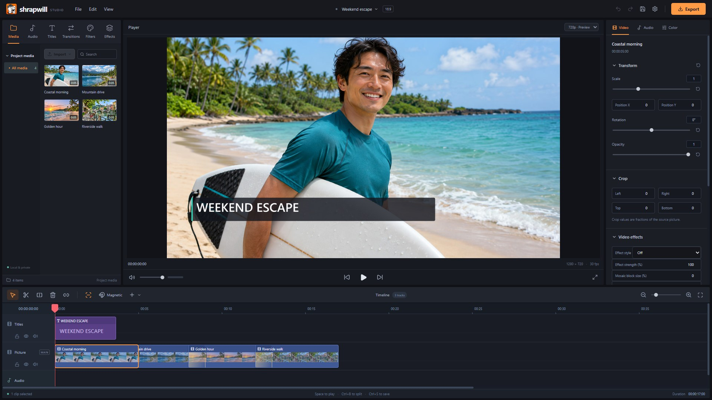
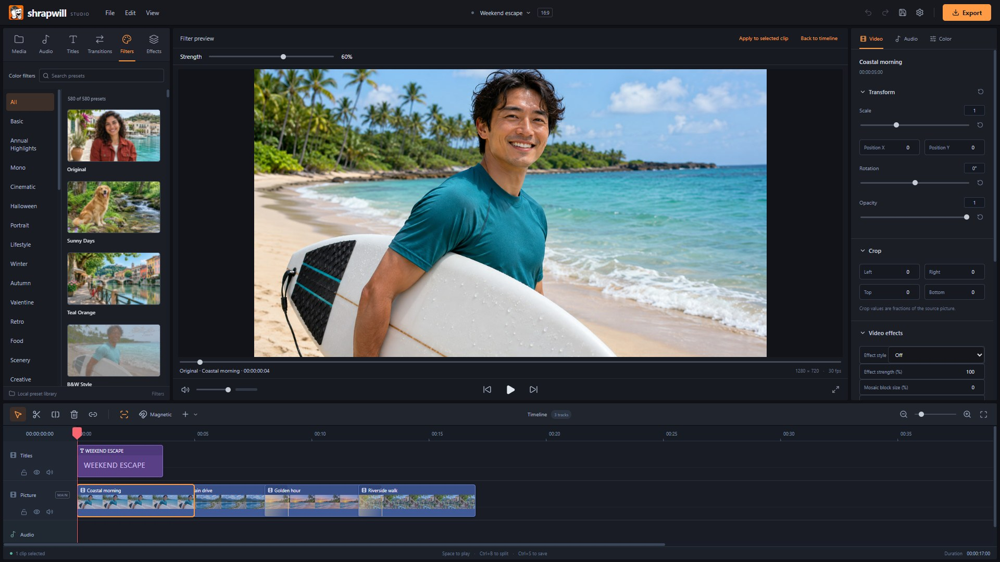
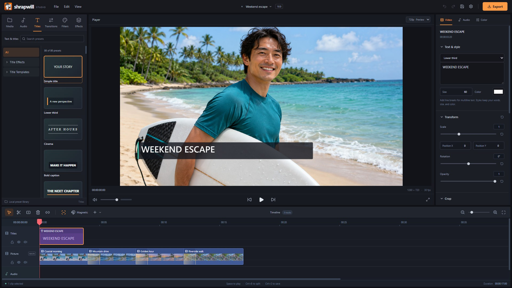

<div align="center">


# Shrapwill

### A straightforward video editor.

For simple everyday projects.

**No account · No subscriptions · No in-app purchases · No ads · No AI upsells**

[**↓ Download for Windows**](https://github.com/Nuqb/shrapwill/releases/latest) ·
[See the editor](#a-quick-look) · [For developers](#for-developers)



</div>

## A quick look

**Import → Arrange → Trim → Add your look → Export**

Bring in video, photos, and audio. Cut them together on a multitrack timeline,
add titles and transitions, adjust the picture and sound, and export an MP4.



**Try the look before adding it.** Preview filters, effects, and transitions;
then apply the ones you want. Your footage and project stay on your computer.



**Start simple. Grow into the controls.** Titles, crop, transforms, color, audio
levels, fades, track locks, customizable shortcuts, and undo are there when you need them.

## Install and make your first edit

1. Open the [latest release](https://github.com/Nuqb/shrapwill/releases/latest)
   and download the **Windows 64-bit installer**.
2. Run the installer and open **Shrapwill**.
3. Create a project, import your media, and drag it onto the timeline.
4. Save your project, then **Export** when you're ready.

**Windows, 64-bit.** The installer includes the local media tools. Microsoft
WebView2 is required; setup can install it if it is missing. No Shrapwill account
or online subscription is needed to edit.

Updater-enabled builds check GitHub for new stable releases on startup. Use
**Settings → Updates** to check manually or change that preference. Downloads
and restarts happen when you choose, with a save prompt before closing edited work.

This is a **preview release**. Keep your original media and save your projects.
For longer instructions, see the [editor guide](Source/docs/editor-guide.md).

---

## For developers

Shrapwill is a local Windows desktop application. **React + TypeScript** present
the interface; **Tauri 2 + a Rust editing core** own projects, history, local
storage, and media processing. Playback uses WebGL 2 and Web Audio. Bundled
FFmpeg/FFprobe handle media work. There is no hosted backend, sign-in service,
remote database, or telemetry pipeline.

### Get the source running

Requirements: Windows x64, Node.js 22.12+, stable Rust, Visual Studio C++ Build
Tools with the Windows SDK, WebView2, and Git LFS.

```powershell
git clone https://github.com/Nuqb/shrapwill.git
cd shrapwill
git lfs install
git lfs pull
cd Source
npm ci
npm run tauri -- dev
```

Large media assets and bundled tools use Git LFS. A checkout containing only LFS
pointer files is insufficient to build the editor. Use a Git/LFS checkout for
development rather than GitHub's automatically generated source ZIP.

### Repository layout

- **Source/** — canonical application, Rust core, tests, scripts, and documentation.
- **App/** — local portable deliveries and the stable launcher; not tracked.
- **Outputs/** — installers, archives, and generated release files; not tracked.
- **QA/** — disposable fixtures, screenshots, and isolated editor profiles; not tracked.
- **Backups/** — preserved older versions; not active source and not tracked.

### Build and check

Run from `Source/`:

```powershell
npm test
npm run format:check
cargo test -p cutline-core
cargo clippy --workspace --all-targets -- -D warnings
npm run tauri -- build
```

The release build creates a Windows installer and publishes a portable build to
the local `App/` directory. Its stable launcher switches to the completed build
without terminating an editor that is already open. See
[CONTRIBUTING](Source/CONTRIBUTING.md) for the complete validation and packaging workflow.

### Project and media handling

- Projects use the `.cutline` format and reference your original media.
- Previews, thumbnails, and waveforms use local caches; original media is preserved.
- Rust owns undoable edits, linked clips, locks, and export planning.
- Browser/native commands go through the desktop service boundary.
- Preset demonstrations use bundled sample photography and the actual renderers.

### Current limits

- Titles support static text. Text animation is not available.
- The broader export comparison still flags an unresolved mismatch for the existing
  Ascii Art preset. Focused desktop preview checks and the app/core tests pass.
- Structural-quality debt is recorded separately; a passing build is not a claim
  that every historical scanner warning is resolved.
- Project files from other editors are not supported.

### Development and contributions

[Architecture](Source/docs/architecture.md) ·
[Contributing](Source/CONTRIBUTING.md) ·
[Quality standards](Source/docs/quality/software-quality.md) ·
[Sample photographs and prompts](Source/docs/preview-photos.md)

Shrapwill code uses the [MIT license](LICENSE). Third-party components and assets
retain their own license terms. See the
[third-party notices](Source/src-tauri/notices/THIRD-PARTY.txt).

Shrapwill is an independent project.

Found a problem? [Open an issue](https://github.com/Nuqb/shrapwill/issues) with the
steps to reproduce it, your Windows version, and the relevant error. Avoid uploading
private project media or credentials.
